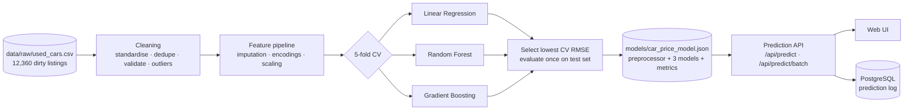

# 🚗 CarValue ML — Used Car Price Prediction

> End-to-end machine-learning system that predicts the market price of a used car from its manufacturer, model, year, mileage, fuel type, transmission and other characteristics — from messy raw data to a tested, documented, containerised prediction API with a web interface.

        

| | |
|---|---|
| **Live app** | `/` price estimator · `/insights` model dashboard · `/docs` API reference · `/api/openapi` OpenAPI 3.1 |
| **Best model** | Gradient Boosting — **R² 0.956**, **MAE $1,742**, **MAPE 9.0 %** on 2,349 held-out vehicles |
| **Calibration** | the 80 % price range contains the real price for **79.7 %** of test vehicles |

---

## What the project does

1. **Data management** — loads 12,360 raw listings, standardises inconsistent labels, parses currency/unit strings, removes duplicates, invalid rows and unusual prices, and prepares features (imputation, encodings, scaling) without data leakage.
2. **Machine learning** — trains **Linear Regression**, **Random Forest** and **Gradient Boosting**, compares them with 5-fold cross-validation, selects the best one, and evaluates it once on an untouched test set (+ permutation importance, learning curve, calibrated price ranges).
3. **Prediction API & interface** — a validated REST API (single + batch) returns an estimate, an 80 % range, all three models' opinions and a 5-year depreciation forecast; a web UI lets anyone enter their car. Every prediction is logged to PostgreSQL.
4. **Testing & deployment** — 44 Vitest + 14 pytest tests, OpenAPI documentation, saved model artifacts, Dockerfiles, docker-compose and a GitHub Actions CI pipeline that retrains the model and enforces a quality bar.

### Two implementations, one dataset

| Layer | Production app (deployed) | Python reference (`/python`) |
|---|---|---|
| Data cleaning | `src/ml/cleaning.ts` | **pandas / NumPy** — `car_price/data.py` |
| Models | Linear regression (Cholesky), histogram CART, random forest & gradient boosting — **implemented from scratch** in TypeScript | **scikit-learn** `LinearRegression`, `RandomForestRegressor`, `HistGradientBoostingRegressor` |
| Visualisation | Recharts dashboard at `/insights` | **Matplotlib** figures in `python/reports/figures/` |
| API | Next.js route handlers + Zod validation | **FastAPI** + Pydantic (`/docs` Swagger UI) |
| UI | Next.js + Tailwind | **Streamlit** |
| Tests | Vitest | **pytest** |
| Packaging | `Dockerfile` (standalone Next.js) | `python/Dockerfile` + compose (API + UI) |

The production app ships as a **single container** with no Python runtime (sub-millisecond inference from a 2.3 MB JSON artifact). The Python package reproduces the same workflow with the industry-standard data-science stack. Both read the same raw CSV and both cleaning pipelines produce **exactly the same 11,746 rows** — a useful cross-check.

---

## Results

### Model comparison (production models — `reports/training_report.md`)

| Model | CV RMSE (mean ± sd) | CV R² | Test R² | Test MAE | Test RMSE | Test MAPE | 80 % range coverage | Fit time |
|---|---:|---:|---:|---:|---:|---:|---:|---:|
| Linear Regression | $4,485 ± $303 | 0.886 | 0.875 | $2,736 | $4,691 | 14.7 % | 79.8 % | 0.02 s |
| Random Forest | $3,716 ± $297 | 0.922 | 0.918 | $2,273 | $3,786 | 11.9 % | 79.5 % | 0.23 s |
| **Gradient Boosting** ✅ | **$2,754 ± $148** | **0.957** | **0.956** | **$1,742** | **$2,781** | **9.0 %** | 79.7 % | 1.11 s |

Selection rule: lowest mean RMSE across 5-fold CV on the training split. The test split (20 %) is used only for the final report.

### Python / scikit-learn reference (`python/models/metrics.json`)

| Model | CV RMSE | Test R² | Test MAE | Test MAPE |
|---|---:|---:|---:|---:|
| Linear Regression | $4,226 | 0.906 | $2,304 | 13.2 % |
| Random Forest | $4,171 | 0.913 | $2,232 | 12.6 % |
| **Gradient Boosting** ✅ | **$3,372** | **0.943** | **$1,860** | **10.0 %** |

Both stacks agree: boosting wins clearly, because depreciation is non-linear and brand-specific (interactions a linear model cannot express).

| Model comparison | Predicted vs actual | Permutation importance |
|---|---|---|
|  |  |  |

**What drives the price** (permutation importance, gradient boosting): make & model 34 %, age 28 %, mileage 18 %, condition 7.5 %, engine size 3.7 %, body type 3.2 %, drivetrain 2.3 %, owners 1.2 %, accident history 0.9 %.

---

## Architecture



```
├── data/raw/used_cars.csv        raw dataset (dirty on purpose)
├── models/car_price_model.json   trained artifact loaded by the API
├── reports/                      training_report.md · metrics.json
├── scripts/                      generate-dataset.ts · train.ts
├── src/
│   ├── ml/                       framework-agnostic ML library
│   │   ├── cleaning.ts           data cleaning + step-by-step report
│   │   ├── preprocess.ts         imputation, feature engineering, encodings
│   │   ├── models/               linear.ts · tree.ts · forest.ts · boosting.ts
│   │   ├── pipeline.ts           CV, selection, evaluation, permutation importance
│   │   ├── predict.ts            inference: ranges, warnings, forecast
│   │   └── synthetic.ts          market simulator used to create the dataset
│   ├── app/                      pages (/, /insights, /docs) + API route handlers
│   ├── components/               form, result panel, charts
│   ├── db/schema.ts              Drizzle schema (predictions table)
│   └── lib/                      Zod validation, OpenAPI spec, model store, logging
├── tests/                        Vitest: unit, pipeline, behavioural, API
├── python/                       pandas · scikit-learn · Matplotlib · FastAPI · Streamlit · pytest
├── Dockerfile · docker-compose.yml
└── .github/workflows/ci.yml
```

---

## 1 · Data management

**Dataset.** `data/raw/used_cars.csv` is generated by a documented market simulator (`src/ml/synthetic.ts`). It covers 20 manufacturers and 123 models, model years 2004–2026, with realistic economics: brand- and model-specific depreciation, enthusiast cars holding value, EV battery ageing, mileage relative to age, a non-linear high-mileage penalty, condition, accidents, owners, trims, drivetrains and market noise. It also contains the quality problems found in real marketplace exports.

> **Why synthetic?** It keeps the repository self-contained and licence-free, and the ground truth is known, so the cleaning steps can be checked. The pipeline is schema-driven: any CSV with the same columns (for example a Kaggle/Craigslist export mapped to these names) works with `npm run train -- path/to/file.csv`.

Columns: `listing_id, manufacturer, model, year, mileage, fuel_type, transmission, body_type, drivetrain, engine_size, condition, owners, accident_history, price`

| Cleaning step | Rows before | Rows after | Removed | Values fixed |
|---|---:|---:|---:|---:|
| Standardise labels & parse values (`'Chevy'→'Chevrolet'`, `'gas'→'Gasoline'`, `'4x4'→'4WD'`, `'$18,450'`, `'45,000 mi'`, `'2.0L'`) | 12,360 | 12,360 | 0 | 12,760 |
| Drop rows missing price or make/model | 12,360 | 12,306 | 54 | 0 |
| Remove duplicate listings (same id, or identical after normalisation) | 12,306 | 11,946 | 360 | 0 |
| Drop invalid model years (1900, 2099, …) | 11,946 | 11,911 | 35 | 0 |
| Nullify impossible values (negative/absurd mileage, engine sizes, owners) | 11,911 | 11,911 | 0 | 26 |
| Remove implausible prices (< $500 or > $500k placeholders) | 11,911 | 11,848 | 63 | 0 |
| Remove statistical price outliers (×10 / ÷10 typos) | 11,848 | **11,746** | 102 | 0 |

**Unusual prices** are handled in two stages: domain bounds catch placeholders, and a *modified z-score* of log(price) inside peer groups (same make & model, 3-year age band, falling back to make-level groups) catches "extra zero" typos. The cut-off is 5 rather than the textbook 3.5. Experiments showed 3.5 removed ~80 genuine (cheap, beaten-up) cars, because legitimate variation inside a peer group is wide, while typos are off by about 10×.

**Missing values** are not dropped. They are imputed inside the model pipeline with statistics learned on training folds only: the mode per model for categoricals, mileage from the median miles/year × age, median engine size per model & fuel type, owners by age, and condition by age band. The API reports which fields were imputed.

**Features:** age, mileage, miles/year, engine size, condition score, owners, accident flag, plus categorical make, model, fuel, transmission, body and drivetrain. The linear model gets standardised numerics (plus age² and log-mileage) and one-hot categoricals. The tree models get **age-adjusted target encoding**: categories are encoded by their smoothed mean residual after removing the global age trend, so "Model Y" isn't rated highly just because every Model Y in the data is young.

## 2 · Machine learning

* **Target:** `log(price)`. Prices are right-skewed and depreciation is multiplicative. Metrics are reported in dollars after exponentiating.
* **Linear Regression:** normal equations solved by Cholesky decomposition on sparse one-hot rows, with λ = 1 for numerical stability only.
* **Random Forest:** 50 bootstrapped histogram trees, depth ≤ 12, min 5 samples/leaf, 70 % of features per split.
* **Gradient Boosting:** 500 trees, learning rate 0.05, depth ≤ 6, 80 % row subsampling, 90 % column subsampling, L2-regularised leaves.
* **Histogram trees:** features are pre-binned into ≤ 255 quantile bins (the LightGBM / `HistGradientBoosting` idea), so a split search costs O(n·features) instead of a sort at every node. The whole pipeline (5-fold CV × 3 models + final fit + permutation importance) runs in **~11 s**.
* **Model selection:** 5-fold CV RMSE on the training split; the test set is touched once.
* **Uncertainty:** the 80 % price range uses the 10th/90th percentiles of out-of-fold log residuals. Its 79.7 % hit-rate on the test set shows it is well calibrated.
* **Interpretability:** model-agnostic permutation importance, the boosting learning curve, predicted-vs-actual plots and error distributions are all shipped inside the artifact and rendered at `/insights`.

## 3 · Prediction API

| Method | Endpoint | Description |
|---|---|---|
| `POST` | `/api/predict` | Estimate one vehicle |
| `POST` | `/api/predict/batch` | Up to 100 vehicles |
| `GET` | `/api/model` | Version, selection rationale, CV/test metrics, hyper-parameters, importance |
| `GET` | `/api/options` | Allowed categories + manufacturer → model catalogue |
| `GET` | `/api/predictions?limit=10` | Recent logged predictions (monitoring) |
| `GET` | `/api/health` | Database + model readiness |
| `GET` | `/api/openapi` | OpenAPI 3.1 specification |

Only `manufacturer`, `model`, `year` and `mileage` are required. Synonyms and casing are normalised (`"chevy"`, `"petrol"`, `"auto"`, `"4x4"`).

```bash
curl -X POST http://localhost:3000/api/predict \
  -H "Content-Type: application/json" \
  -d '{"manufacturer":"Toyota","model":"RAV4","year":2020,"mileage":45000,"fuel_type":"Hybrid","transmission":"Automatic","drivetrain":"AWD","condition":"Good","owners":1,"accident_history":false}'
```

```json
{
  "estimated_price": 19250,
  "currency": "USD",
  "price_range": { "low": 16750, "high": 22250, "confidence": 0.8 },
  "model_used": "gradient_boosting",
  "model_version": "2026.10.12-605e62e",
  "model_predictions": { "linear_regression": 18850, "random_forest": 17450, "gradient_boosting": 19250 },
  "vehicle": { "manufacturer": "Toyota", "model": "RAV4", "year": 2020, "mileage": 45000, "fuel_type": "Hybrid", "...": "..." },
  "imputed_fields": [],
  "warnings": [],
  "depreciation_forecast": [
    { "year": 2026, "vehicle_age": 6, "mileage": 45000, "estimated_price": 19250 },
    { "year": 2027, "vehicle_age": 7, "mileage": 52500, "estimated_price": 18400 },
    { "year": 2028, "vehicle_age": 8, "mileage": 60000, "estimated_price": 16200 }
  ]
}
```

Invalid JSON → `400`. Schema violations → `422` with field-level details, e.g. `{"error":"Validation failed","details":[{"field":"year","message":"Too big: expected number to be <=2027"}]}`.

**Web interface (`/`):** dependent make → model dropdowns, quick presets, optional "not sure" fields, the estimate with its range, a side-by-side comparison of all three models, a 5-year value forecast, imputed-field chips, a "reproduce with cURL" snippet and a live table of recent predictions from PostgreSQL.

## 4 · Getting started

**Requirements:** Node 20+ and PostgreSQL (or Docker). Python 3.11 for the reference implementation.

```bash
# Web app + API
npm install
npm run data:generate     # regenerate data/raw/used_cars.csv (deterministic, seed 2026)
npm run train             # clean → CV → select → models/car_price_model.json + reports/
npm test                  # 44 Vitest tests (unit, pipeline, behavioural, API)
npm run dev               # http://localhost:3000   (DATABASE_URL in .env)

# Python reference
cd python
pip install -r requirements.txt
python -m car_price.train             # trains, compares, saves model + Matplotlib figures
pytest -q                             # 14 tests
uvicorn api.main:app --reload         # http://localhost:8000/docs
streamlit run app/streamlit_app.py    # http://localhost:8501
```

The `predictions` table is created automatically on first use (idempotent `CREATE TABLE IF NOT EXISTS`). Alternatively, run `npx drizzle-kit push`.

## Testing

| Suite | What is covered |
|---|---|
| `tests/cleaning.test.ts` | label synonyms, number parsing, CSV round-trip, alias resolution, duplicates, invalid rows, ×10/÷10 outliers |
| `tests/models.test.ts` | linear regression recovers known coefficients, histogram binning ≡ raw thresholds, RF/GBM learn non-linear functions, determinism |
| `tests/preprocess.test.ts` | model-aware imputation, unseen categories, scaling |
| `tests/pipeline.test.ts` | end-to-end training, selection by CV, JSON round-trip of the artifact |
| `tests/predict.test.ts` | behavioural tests on the saved model: newer > older, low > high mileage, accidents/condition penalties, luxury > economy, synonym robustness, monotone forecast |
| `tests/api.test.ts` | route handlers: 200/400/422 contracts, batch, model/options/OpenAPI endpoints (DB mocked) |
| `python/tests/` | pandas cleaning, sklearn model comparison & predictor behaviour, FastAPI endpoints & validation |

## Deployment

```bash
docker compose up --build                    # web app + API + PostgreSQL → http://localhost:3000
cd python && docker compose up --build       # FastAPI (:8000/docs) + Streamlit (:8501)
docker build --build-arg RETRAIN=true .      # retrain inside the image
```

The root `Dockerfile` runs the tests, builds a standalone Next.js server and ships only the runtime and the model artifact. It deploys to any container host (Render, Fly.io, Railway, Cloud Run, ECS); just set `DATABASE_URL`. **CI** (`.github/workflows/ci.yml`) type-checks, runs both test suites, **retrains the model and fails if test R² < 0.90**, builds the app and builds the Docker image.

## Limitations & next steps

* The data is simulated. Swapping in a real export only needs a column mapping, and the cleaning report will show its specific quality issues.
* Prices reflect a single market snapshot (`referenceYear = 2026`). A production system would add time-aware validation and periodic retraining from the logged predictions plus observed sale prices.
* Possible extensions: quantile regression for asymmetric ranges, SHAP explanations per prediction, drift monitoring on the `predictions` table, and A/B routing between model versions.

## License

MIT — see [LICENSE](LICENSE).
